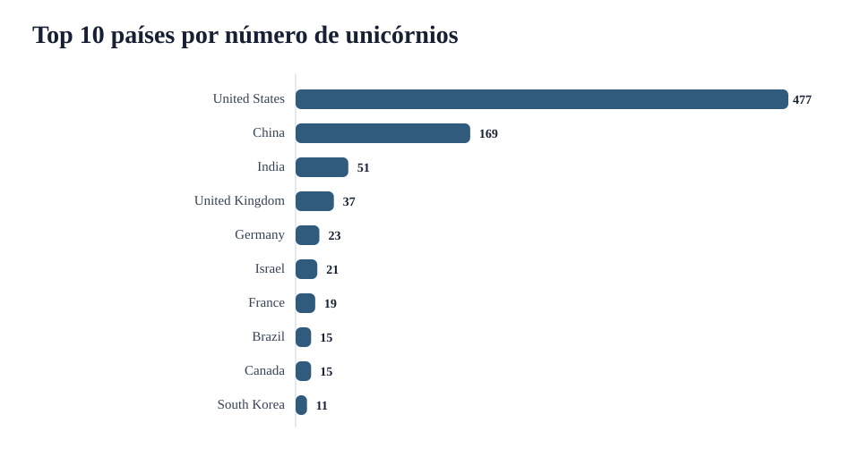
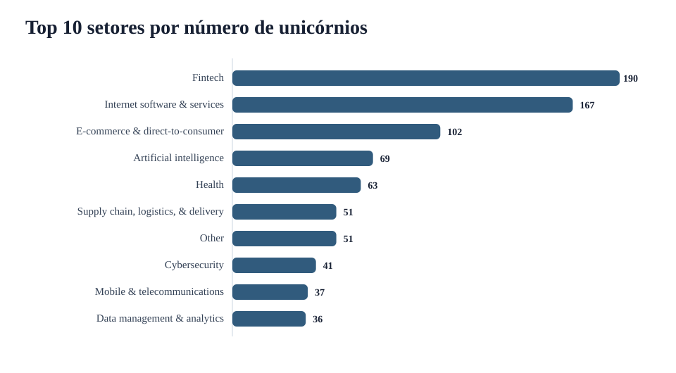
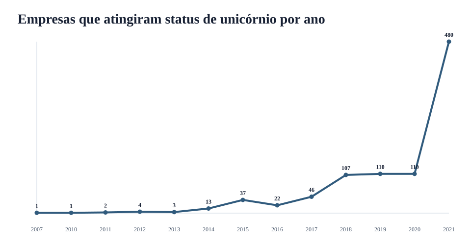
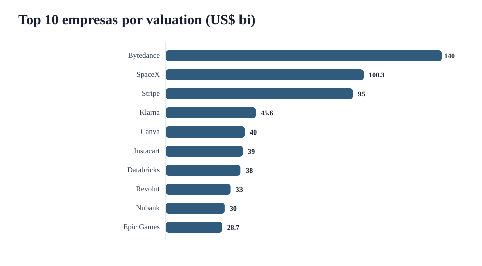
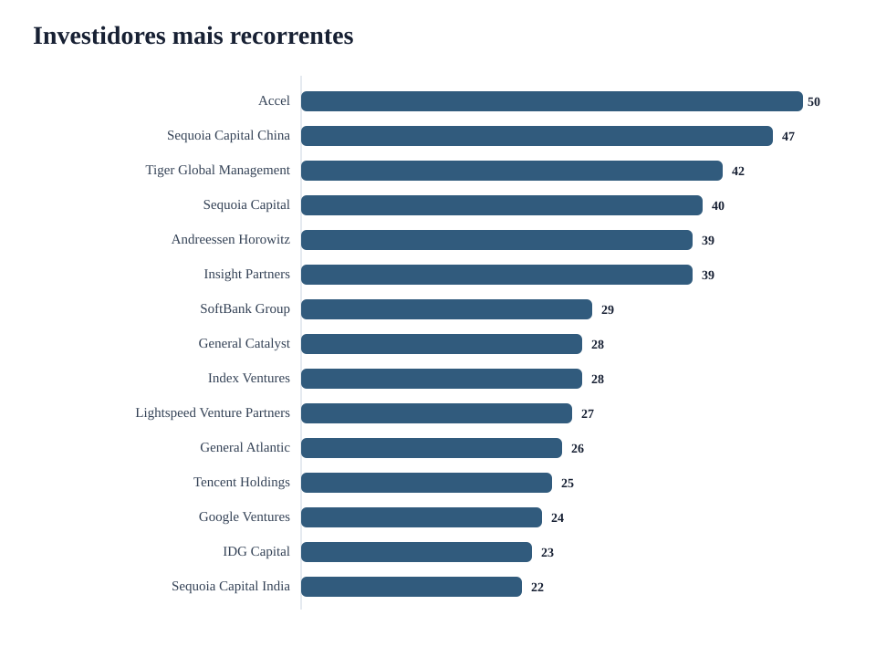
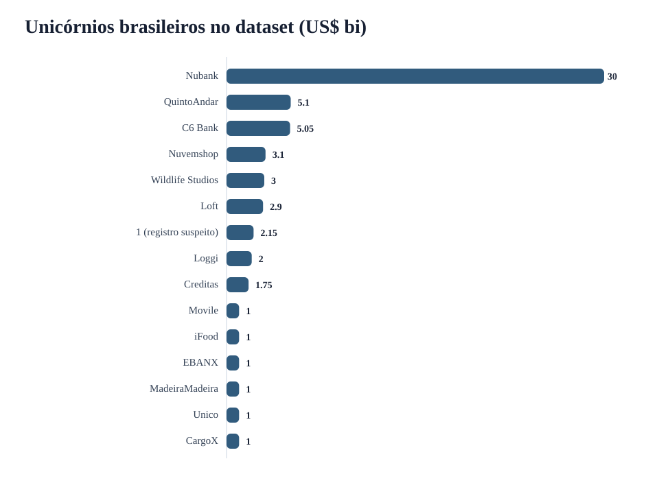

# Case Empresas Unicórnio — Análise Exploratória com Python

Projeto de portfólio em **Python e Análise de Dados** que explora um snapshot histórico de empresas unicórnio.

A análise investiga distribuição geográfica, setores, evolução temporal, maiores valuations, investidores recorrentes e um recorte específico das empresas brasileiras.

## Problema de negócio

Empresas unicórnio são startups privadas avaliadas em pelo menos US$ 1 bilhão. O objetivo deste case é transformar uma base bruta em informação útil para responder perguntas como:

- Em quais países os unicórnios estão concentrados?
- Quais setores aparecem com maior frequência?
- Como evoluiu a entrada de novos unicórnios ao longo do tempo?
- Quais empresas possuem os maiores valuations?
- Quais investidores aparecem com maior frequência?
- Como o Brasil se posiciona no conjunto analisado?

## Dataset

O arquivo analisado possui:

- **936 empresas**
- **47 países**
- **17 setores**
- período de entrada no status de unicórnio entre **20/07/2007 e 07/12/2021**
- valuation total do snapshot de aproximadamente **US$ 3.071,16 bilhões**

O dataset é histórico e não deve ser interpretado como uma fotografia atual do mercado.

**Arquivo usado no case:** `data/raw/startups_2021_end.csv`

**Fonte pública correspondente:** [prasertcbs/basic-dataset — Startups in 2021 end.csv](https://github.com/prasertcbs/basic-dataset/blob/master/Startups%20in%202021%20end.csv)

### Colunas originais

| Coluna | Descrição |
|---|---|
| Company | Nome da empresa |
| Valuation ($B) | Valuation em US$ bilhões |
| Date Joined | Data em que atingiu status de unicórnio |
| Country | País |
| City | Cidade |
| Industry | Setor |
| Select Investors | Investidores selecionados |

## Qualidade e preparação dos dados

Durante a preparação:

- a coluna de índice `Unnamed: 0` foi removida;
- valuation foi convertido de texto para número;
- datas foram convertidas para `datetime`;
- foi criada a variável `Join_Year`;
- **15 cidades ausentes** foram sinalizadas como `Não informado`;
- **1 registro de investidores ausente** foi sinalizado;
- foi identificado **1 nome de empresa repetido**.

O nome repetido é **Bolt**, mas os registros representam empresas diferentes — uma fintech dos Estados Unidos e uma empresa de mobilidade da Estônia — portanto não foi feita remoção automática.

Também foi identificado um registro suspeito em que o campo `Company` contém apenas `1`. O registro foi preservado e documentado em [`reports/data_quality.md`](reports/data_quality.md), evitando uma correção silenciosa da fonte.

## Principais resultados

### 1. Concentração geográfica

Os Estados Unidos possuem **477 empresas**, cerca de **51%** da base. China aparece em segundo lugar, seguida por Índia e Reino Unido.



### 2. Setores

**Fintech** lidera com **190 empresas**, seguida por **Internet software & services**, com **167**.



### 3. Evolução temporal

O ano de **2021** concentra **480 novos unicórnios** no dataset, indicando forte aceleração no período observado.



### 4. Maiores valuations

Bytedance, SpaceX e Stripe aparecem no topo do snapshot analisado.



### 5. Investidores recorrentes

A análise separa os nomes presentes em `Select Investors` e conta suas aparições. Accel, Sequoia Capital China, Tiger Global Management e Sequoia Capital estão entre os mais recorrentes.



### 6. Brasil

O Brasil possui **15 registros** na base. Nubank aparece com valuation de **US$ 30 bilhões** no snapshot. Um dos registros brasileiros contém o nome suspeito `1`, mantido como veio na fonte e destacado no relatório de qualidade.



## Estrutura do projeto

```text
Analise_Dados_Empresas_Unicornio/
├── .github/
│   └── workflows/
│       └── python-tests.yml
├── data/
│   ├── raw/
│   │   └── startups_2021_end.csv
│   └── README.md
├── notebooks/
│   └── unicorn_companies_analysis.ipynb
├── reports/
│   ├── figures/
│   │   ├── brazil_unicorns.svg
│   │   ├── top_countries.svg
│   │   ├── top_industries.svg
│   │   ├── top_investors.svg
│   │   ├── top_valuations.svg
│   │   └── unicorns_by_year.svg
│   ├── data_quality.md
│   └── summary.json
├── src/
│   ├── __init__.py
│   ├── analysis.py
│   └── data_cleaning.py
├── tests/
│   └── test_cleaning.py
├── .gitignore
├── LICENSE
├── README.md
└── requirements.txt
```

## Como executar

Crie um ambiente virtual:

```bash
python -m venv .venv
```

Ative o ambiente no Windows:

```bash
.venv\Scripts\activate
```

No Linux/macOS:

```bash
source .venv/bin/activate
```

Instale as dependências:

```bash
pip install -r requirements.txt
```

Execute a análise pelo terminal:

```bash
python -m src.analysis
```

Ou abra o notebook:

```text
notebooks/unicorn_companies_analysis.ipynb
```

## Testes

```bash
pytest -q
```

O repositório possui GitHub Actions para executar os testes automaticamente em pushes e pull requests.

## Tecnologias

- Python
- Pandas
- NumPy
- Matplotlib
- Jupyter Notebook
- Pytest
- GitHub Actions

## Limitações

- O dataset representa um **snapshot histórico**, não a lista atual de unicórnios.
- Valuation não equivale a receita, lucro ou retorno realizado.
- `Select Investors` apresenta apenas investidores selecionados.
- A análise é descritiva e não estabelece relações causais.

## Autor

**Pablo Sena**

GitHub: [@pablosena28](https://github.com/pablosena28)
